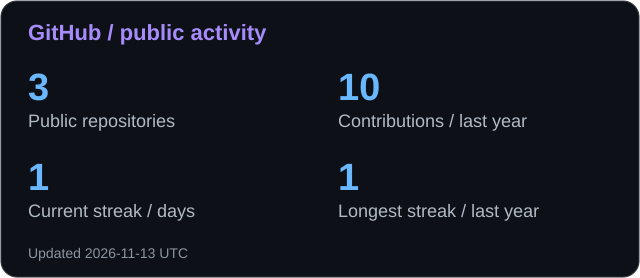
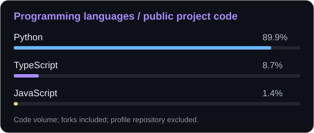
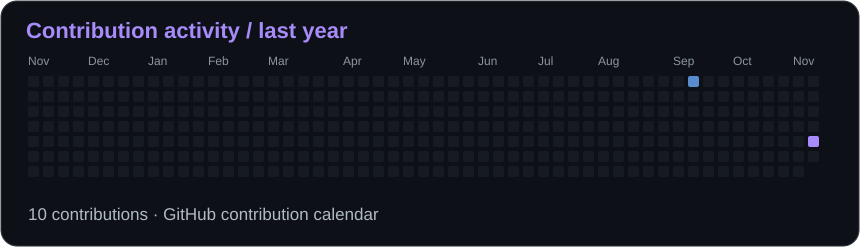

<picture>
  <source media="(prefers-reduced-motion: reduce)" srcset="assets/header-static.png">
  
</picture>

# Hi, I'm G0d0v.

**Independent Developer · Infrastructure Engineer · AI Builder**

Building software, engineering infrastructure, and exploring AI-powered technologies.

[About](#about-me) · [Expertise](#areas-of-expertise) · [Stack](#technology-stack) · [Projects](#featured-projects) · [Activity](#github-statistics) · [Contact](#contact)

## About me

I build software products and the systems behind them: backend services, web applications,
network infrastructure, automation, and local AI tooling.

My work spans independent products, server operations, and open-source development.
I care about usable interfaces, maintainable systems, and reliable deployment and recovery.

## Areas of expertise

| Software engineering | Infrastructure engineering | AI & automation |
| :--- | :--- | :--- |
| Backend APIs and full-stack web apps | Linux servers and containerised services | Local LLM tooling and voice workflows |
| Telegram bots, WebApps and admin tools | VPN, proxies and network routing | AI agents and MCP integrations |
| Product integrations and performance | Deployment, backups and safe updates | Workflow and operations automation |

## Programming languages

**Python · TypeScript · JavaScript** — detected in my public project repositories by GitHub Linguist.

| Category | Technologies | Context |
| :--- | :--- | :--- |
| Shell & automation | Bash / Shell, PowerShell, Windows Batch | Detected in public project code |
| Web technologies | HTML, CSS | Detected in public project code; markup and styling |
| Query languages | SQL | PostgreSQL, SQLite and MySQL / MariaDB project work |
| Configuration & infrastructure | Dockerfile, YAML, JSON, TOML | Containers, application configuration and tooling |
| Additional project experience | PHP, Java | Web and Minecraft ecosystem work, including LunaCORE |

Technology exposure & interests

Local model serving, Qwen, Qwen3-TTS, agent tools, MCP, API integrations,
network transports, and deployment automation. These describe areas of work and exploration,
not a claim of expert proficiency in every tool or language.

## Technology stack

| Area | Selected tools |
| :--- | :--- |
| Backend | Python, Flask, FastAPI, Node.js, PHP, REST APIs |
| Frontend | React, Next.js, Vue 3, TypeScript, Tailwind CSS, Vite |
| Data | PostgreSQL, SQLite, MySQL / MariaDB |
| Infrastructure & DevOps | Linux, Ubuntu, Docker, Compose, Nginx, Git, GitHub Actions, VPS, reverse proxies |
| Networking | Xray, VLESS, SOCKS5 / HTTP proxies, WebSocket, gRPC, XHTTP, Hysteria2 |
| AI & automation | Local LLMs, Qwen, Qwen3-TTS, AI agents, MCP, workflow automation |

## Featured projects

Selected engineering work, including projects outside my public GitHub repositories.
Public source links are included where available.

### ADS AVANGARD PLATFORM

An advertising marketplace connecting brands with content creators.
Product work across marketplace experiences, campaign workflows, and web applications.

### LunaVPN

A VPN product and network-infrastructure workstream, connecting service operations,
automation, and customer-facing software.

### LunaCORE

A Minecraft ecosystem project spanning a website, administration tools, launcher,
and server-side integrations.

### Local AI & agent workflows

Local language-model and voice tooling, AI-agent workflows, and MCP integrations.
An ongoing engineering workstream rather than a single public repository.

### [Remnawave SHOP — godovwwq edition](https://github.com/G0d0v/remnawave-shopbot)

An enhanced edition of Remnawave SHOP featuring a redesigned admin dashboard,
Telegram WebApp, visual interface builder, RollyPay integration, and safe upstream update tooling.

My engineering work includes interface customisation, backup and rollback tooling,
Docker operations, and automated checks.
Based on [CyberERROR/remnawave-shopbot](https://github.com/CyberERROR/remnawave-shopbot);
the original authors retain credit and the project's MIT notices are preserved.

## GitHub statistics

These are GitHub measurements, not proficiency scores. Language totals include upstream code
in forks and exclude this profile repository. Work outside public GitHub is not represented.

## Contribution activity

Generated from GitHub's contribution calendar. Statistics are refreshed by this repository's
[workflow](https://github.com/G0d0v/G0d0v/actions/workflows/profile-stats.yml).

## Current focus

- Building independent software products with a stronger backend and infrastructure foundation.
- Improving deployment, observability, performance, and recovery workflows.
- Connecting local AI, voice tooling, agents, and useful everyday automation.
- Sharing selected engineering work through open source.

## Contact

[GitHub · @G0d0v](https://github.com/G0d0v)

---

About this profile's visuals and data

The lunar header is an original procedural animation with a static version for reduced-motion
preferences. Statistics are SVG files stored in this repository, generated with GitHub's REST
and GraphQL APIs; they do not rely on an external statistics image server.
Technology icons are provided by [Skill Icons](https://github.com/tandpfun/skill-icons).
See [profile maintenance](docs/PROFILE_MAINTENANCE.md) for data scope and rendering commands.

