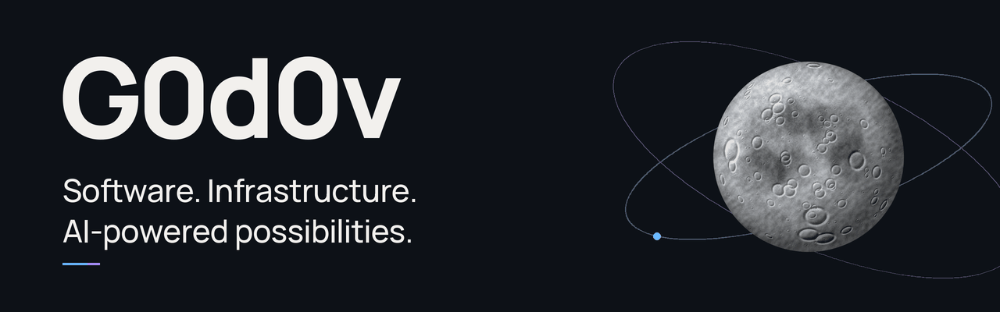
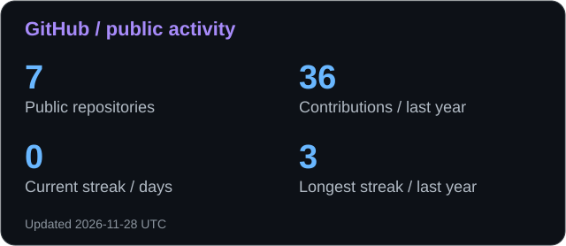
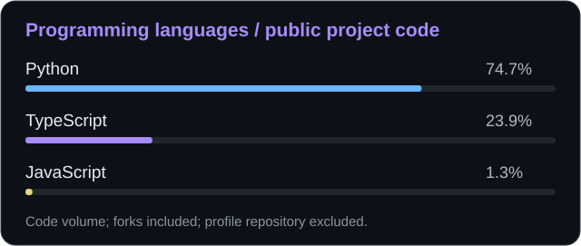
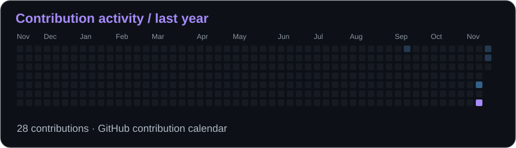

<picture>
  <source media="(prefers-reduced-motion: reduce)" srcset="assets/header-static.png">
  
</picture>

# G0d0v

**Разработка продуктов · Интерфейсы · Инфраструктура · ИИ**

Создаю WebApp для Telegram-ботов, веб-приложения и серверные сервисы. Проектирую интерфейс, связываю его с API и платежами, настраиваю инфраструктуру и довожу продукт до запуска.

Мои проекты объединяют несколько направлений: дизайн, клиентскую и серверную разработку, работу с сетями и автоматизацию. Могу собрать новый продукт с нуля или развить уже работающий сервис.

**[Портфолио WebApp](https://github.com/G0d0v/telegram-webapp-portfolio)** · [Что я делаю](#что-я-делаю) · [Проекты](#проекты) · [Технологии](#технологии) · [Обсудить WebApp](#обсудить-webapp)

## Что я делаю

| Направление | Работа |
| :--- | :--- |
| **WebApp и Telegram-боты** | Личные кабинеты, подписки, тарифы, баланс, платежи, управление устройствами и интеграция с ботом |
| **Дизайн и анимация** | Интерфейсы с собственным стилем, адаптивная вёрстка, светлые и тёмные темы, анимации и обратная связь |
| **Серверная разработка** | API, бизнес-логика, базы данных, интеграции и автоматизация операций |
| **Инфраструктура и DevOps** | Linux, Docker, VPS, HTTPS, развёртывание, мониторинг, резервное копирование и восстановление |
| **VPN и сети** | Remnawave, Xray, маршрутизация, клиентские приложения и инфраструктура VPN-сервисов |
| **ИИ и автоматизация** | Локальные модели, голосовые инструменты, ИИ-агенты, MCP и автоматизация рабочих процессов |

## Интерфейсы, которые я создаю

У каждого сервиса свой характер. Светлая **Astra Route**, синий **ANY VPN**, розовая **Luna VPN**, фиолетовый **Паук VPN** и визуальный конструктор **Agora** — примеры моих работ по дизайну и разработке WebApp.

  
  
  

**[Открыть портфолио: все проекты, экраны и анимации](https://github.com/G0d0v/telegram-webapp-portfolio)**

Разрабатываю WebApp не только для VPN: такие интерфейсы подходят ботам с подписками, магазинам цифровых товаров, образовательным сервисам и другим продуктам с личным кабинетом.

## Проекты

| Проект | Что внутри |
| :--- | :--- |
| **[Портфолио Telegram WebApp](https://github.com/G0d0v/telegram-webapp-portfolio)** | Пять визуальных направлений: Astra Route, ANY VPN, Luna VPN, Паук VPN и Agora. Скриншоты, пользовательские сценарии и анимация платёжного чека |
| **[ANY VPN](https://github.com/G0d0v/any-vpn-showcase)** | Кейс пользовательской WebApp и панели ANY VPN CONTROL: интерфейсы, анимации, подписки и архитектура сервиса |
| **[LunaVPN для Windows](https://github.com/G0d0v/LunaVPN-programm)** | VPN-клиент с выборочным туннелированием для игр и приложений, Electron, sing-box и серверная часть с подписками и оплатой |
| **[Remnawave SHOP · моя редакция](https://github.com/G0d0v/remnawave-shopbot)** | Доработанная админ-панель, Telegram WebApp, визуальный конструктор, RollyPay, резервное копирование и инструменты обновления |
| **[Remnawave Installer](https://github.com/G0d0v/remnawave-installer)** | Автоматизация установки панели, узлов, Reality selfsteal и интеграции с ShopBot |
| **[D2D Platform](https://github.com/G0d0v/d2d-platform)** | Платформа для закрытого сообщества разработчиков: Git, задачи, обсуждения, ИИ-агенты и установка на своих серверах |

Другие направления работы

- **ADS AVANGARD PLATFORM** — рекламная площадка, связывающая бренды и авторов контента: маркетплейс, работа с кампаниями и веб-приложения.
- **LunaCORE** — Minecraft-экосистема: сайт, инструменты администрирования, лаунчер и серверные интеграции.
- **Локальные ИИ-инструменты** — работа с языковыми моделями, Qwen, Qwen3-TTS, голосовыми сценариями, агентами и MCP.

## Технологии

| Область | Инструменты |
| :--- | :--- |
| **Основные языки** | Python, TypeScript, JavaScript |
| **Интерфейсы** | React, Next.js, Vue 3, HTML, CSS, Tailwind CSS, Vite |
| **Серверная часть** | FastAPI, Flask, Node.js, REST API; PHP в отдельных проектах |
| **Данные** | PostgreSQL, SQLite, MySQL / MariaDB, SQL |
| **Инфраструктура** | Linux, Ubuntu, Docker, Compose, Nginx, GitHub Actions, VPS |
| **Сети** | Xray, VLESS, Hysteria2, SOCKS5 / HTTP, WebSocket, gRPC, XHTTP |
| **Автоматизация** | Bash, PowerShell, Git, ИИ-агенты и MCP |

О технологиях и опыте

Стек отражает инструменты из моих проектов и направлений работы. Основные языки в публичных репозиториях — Python, TypeScript и JavaScript. Также есть опыт PHP и Java, в том числе в веб-проектах и Minecraft-экосистеме. Набор технологий для конкретной задачи выбираю под сам продукт и его инфраструктуру.

## Активность на GitHub

Как обновляется статистика

Изображения формируются из данных GitHub REST и GraphQL API и хранятся в этом репозитории. Их обновляет [GitHub Actions](https://github.com/G0d0v/G0d0v/actions/workflows/profile-stats.yml).

Это показатели публичной активности, а не оценки навыков. Распределение языков включает код исходных проектов в форках; работа за пределами публичных репозиториев в статистике не отражена.

## Обсудить WebApp

Нужна WebApp для вашего Telegram-бота — с нуля или с редизайном существующего интерфейса?

**[Расскажите о задаче](https://github.com/G0d0v/telegram-webapp-portfolio/issues/new?template=project-request.yml)**

Для начала достаточно описать назначение бота, основные действия пользователя и нужные функции: подписки, платежи, каталог, личный кабинет или интеграции.

---

Об авторстве и материалах

Доработки Remnawave SHOP основаны на [CyberERROR/remnawave-shopbot](https://github.com/CyberERROR/remnawave-shopbot); авторство исходного проекта и уведомления MIT сохранены. Иконки технологий — [Skill Icons](https://github.com/tandpfun/skill-icons).

Лунный баннер — оригинальная процедурная анимация со статичным вариантом для системной настройки уменьшения движения. Технические сведения об оформлении и данных: [обслуживание профиля](docs/PROFILE_MAINTENANCE.md).

