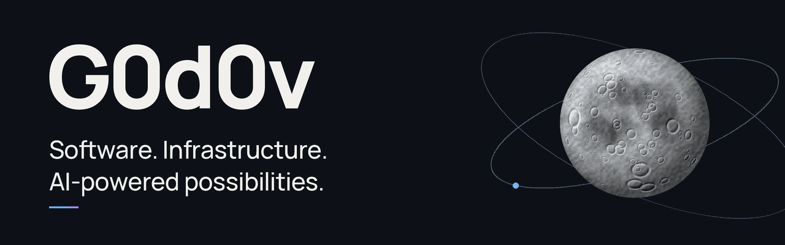

<picture>
  <source media="(prefers-reduced-motion: reduce)" srcset="assets/header-static.png">
  
</picture>

## Идеи, которые работают.

Создаю VPN-сервисы, Telegram-ботов и инструменты автоматизации.
Превращаю сложную инфраструктуру в продукты, которыми удобно пользоваться.

| Связь | Продукт | Автоматизация |
| :--- | :--- | :--- |
| VPN и сетевая инфраструктура | Telegram-боты, WebApp и панели управления | Развёртывание, обновления и повседневные задачи |

### В работе

**[remnawave-shopbot](https://github.com/G0d0v/remnawave-shopbot)**

Доработки Telegram-магазина на базе Remnawave: WebApp, админка и инструменты обновления.
Основан на открытом проекте [CyberERROR/remnawave-shopbot](https://github.com/CyberERROR/remnawave-shopbot).

### Инструменты

`Python` · `TypeScript` · `React` · `Flask` · `Docker` · `Linux`

---

Хороший интерфейс снаружи. Продуманная система внутри.
